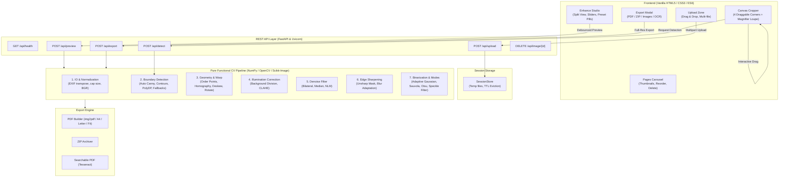

# DocScan Architecture & System Design

DocScan is a high-performance, classical computer vision document scanning application that converts camera photographs of paper documents into straight, evenly illuminated, sharp, scanner-quality images and multi-page PDFs.

---

## 1. High-Level System Architecture

---

## 2. End-to-End Data Flow

### Phase 1: Ingestion & Session Allocation (`POST /api/upload`)
1. User drops one or more image files (JPG, PNG, WEBP, BMP, TIFF) into the browser.
2. The browser submits each file as `multipart/form-data`.
3. `server.py` validates file size (maximum 25 MB).
4. `io_utils.py` reads the image stream via Pillow, corrects any EXIF rotation (`ImageOps.exif_transpose`), converts RGBA transparency to solid white background, converts to BGR uint8, and caps the longest side to 4000 px.
5. The original image is assigned a unique UUID and cached on disk in the system temp directory (`session_store`).
6. The endpoint returns `{ image_id, width, height, preview_url }`.

### Phase 2: Document Boundary Detection (`POST /api/detect`)
1. The server loads the session image and downscales a copy to 600 px height for low-latency detection (< 25 ms).
2. `detect.py` computes automatic Canny hysteresis thresholds based on the image median.
3. Morphological closing connects broken edge segments.
4. `findContours` extracts candidate contours sorted by area; `approxPolyDP` (epsilon ~ 2% arc length) searches for a convex 4-point quadrilateral covering > 18% of the frame.
5. If no quadrilateral satisfies the primary detector, fallback algorithms run:
   - **Fallback A**: Color & saturation segmentation isolating paper hues followed by `minAreaRect`.
   - **Fallback B**: Morphological gradient filtering followed by contour bounding box.
   - **Fallback C**: Full-image bounding frame with `detected=False` flag.
6. A confidence score [0.0 - 1.0] is evaluated considering edge support, area ratio, aspect ratio sanity, and convexity.
7. Coordinates are scaled back to original image space and returned to the UI.

### Phase 3: Interactive Corner Adjustment & Magnifier Loupe
1. The frontend renders the downscaled image on an HTML5 `<canvas>`.
2. 4 glowing interactive handles (Top-Left, Top-Right, Bottom-Right, Bottom-Left) are drawn over the corners.
3. The user can drag any corner via mouse or touch.
4. During handle movement, a floating **Magnifier Loupe** displays a 2.5x zoomed view with crosshairs for millimeter-precision edge alignment.
5. Action buttons allow instant re-detection, reset to full image, or 90° clockwise rotations.

### Phase 4: Real-Time Downscaled Enhancement Preview (`POST /api/preview`)
1. When adjusting sliders or preset pills (Auto, B&W, Color Enhanced, Grayscale, Handwriting, Original), changes are debounced (140 ms).
2. Any in-flight preview request is immediately cancelled using `AbortController`.
3. The server runs `pipeline.process(image, corners, params, preview=True)` in a thread pool (`asyncio.to_thread`):
   - Perspective transformation using `INTER_CUBIC` interpolation.
   - Downscaling the warped quad to <= 1200 px for ultra-fast intermediate filtering.
   - Dynamic mode classification if set to "Auto" (analyzing HSV saturation, ink pixel density, and stroke width distance transform).
   - Illumination background estimation and shadow division.
   - Selective denoising (none, bilateral, median, or Non-Local Means).
   - Unsharp masking with blur variance adaptation.
   - Adaptive binarization (Sauvola or Gaussian) and connected-component speckle removal.
4. Result is returned as JPEG bytes and displayed in the side-by-side Before/After preview.

### Phase 5: Full-Resolution Export (`POST /api/export`)
1. When the user clicks "Download", the frontend sends the list of all pages with their saved corners and settings.
2. The server loads each original full-resolution image from `session_store`.
3. The identical processing pipeline runs at **100% full resolution**.
4. Output generation:
   - **PDF**: Packaged losslessly using `img2pdf` with layout matching (A4, Letter, or Fit).
   - **Searchable PDF**: If Tesseract OCR is enabled, text layers are embedded into the PDF.
   - **ZIP**: Multi-page documents bundled as compressed PNG or JPEG archives.
5. The file is streamed back with proper `Content-Disposition` headers triggering instant browser download.

---

## 3. Concurrency & Performance Design

- **Thread Pool Execution**: All image warping, filtering, and export tasks run in worker threads via `asyncio.to_thread`, keeping the FastAPI asynchronous event loop completely unblocked.
- **Preview vs Full-Res Isolation**: The interactive UI operates strictly on downscaled copies (max 1200 px), delivering sub-150 ms interactive feedback. Full-resolution processing only executes during final export.
- **TTL Session Store**: Session images stored in the temporary directory are tracked with timestamps. A background asynchronous loop purges sessions inactive for more than 1 hour. On server shutdown, all session files are wiped cleanly.
