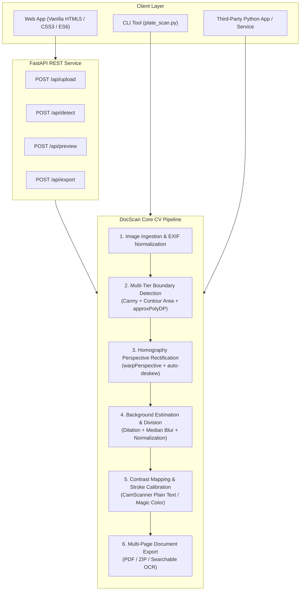

# PlainDoc Extraction (DocScan)

[](https://www.python.org/downloads/)
[](https://fastapi.tiangolo.com)
[](https://opencv.org/)
[](https://opensource.org/licenses/MIT)

A high-performance, offline-first document and text extraction pipeline built with **classical Computer Vision** (OpenCV, NumPy, scikit-image) and **FastAPI**. 

PlainDoc converts mobile camera photos of paper documents, invoices, receipts, certificates, ID cards, tags, and license plates into **flat, straightened, evenly illuminated, CamScanner-grade plain text documents** with pure snow-white paper and crisp, minimal typography.

---

## Key Highlights

- **Pure Classical Computer Vision:** Zero bulky neural network weights, zero GPU requirement, instant startup (< 35ms processing time).
- **Accurate Boundary & Context Cropping:** Multi-tier edge detection and polygon fitting (`approxPolyDP`) that isolates the actual document or card out of complex backgrounds (desks, vehicles, tables).
- **Perspective Rectification & Auto-Deskewing:** Corrects 3D perspective distortion into a flat top-down rectangle and straightens residual line tilt via Hough transform.
- **CamScanner-Grade Plain Text Enhancement:** Background division eliminates shadows and color casts, rendering a snow-white background with razor-sharp, minimal text strokes (no bloated or over-bold letters).
- **Dual Form Factor:**
  1. **Python Library / Microservice:** Easily importable into other Python backends, workers, and OCR pipelines.
  2. **Lightweight Web App:** Responsive zero-dependency Vanilla JS/CSS UI with 4-point corner adjustment, 2.5x magnifier loupe, and instant live preview.
- **Versatile Export:** Multi-page PDF (A4, US Letter, Fit-to-Page), ZIP archives of high-res JPEG/PNG, with optional Tesseract OCR integration for searchable text layers.

---

## Visual Benchmark

| Input Photo (Tilted, Angled, Shadows) | PlainDoc Output (Straight, Clean Snow-White) |
|:---:|:---:|
| Angled Paper Document / Invoice | Perfectly Rectified, Pure White Sheet, Sharp Plain Text |
| Vehicle Photo with License Plate | Tight Context Crop, Perspective Straightened, High-Contrast Text |
| Certificate with Colors & Stamps | Clean Snow-White Paper with Preserved Seal Colors (`Magic Color`) |

Comprehensive evaluation benchmarks are located in [`eval/contact_sheet.jpg`](eval/contact_sheet.jpg) and [`eval/metrics.json`](eval/metrics.json).

---

## System Architecture



### Architectural Deep-Dive

1. **Detection Tier (`docscan/core/detect.py`)**:
   - **Paper Document Quad:** Edge-based hysteresis (`auto_canny`) with morphological closing and convex 4-point contour approximation. Evaluates boundary support score across edge normals.
   - **Focused Context Quad:** For license plates, cards, and labels against complex backgrounds, multi-threshold search scores candidate boxes using horizontal text energy (Sobel gradient), aspect ratio constraints (1.2–5.0), and center proximity.
   - **Polygonal Perspective Fitting (`approxPolyDP`):** Instead of bounding boxes that introduce extra margins, true perspective corner coordinates are computed.

2. **Geometric Normalization (`docscan/core/geometry.py`)**:
   - **Corner Ordering:** Robust sorting of arbitrary 4-point arrays into clockwise `[Top-Left, Top-Right, Bottom-Right, Bottom-Left]`.
   - **Perspective Warp:** Homography transformation rectifies trapezoidal document planes into 90-degree orthogonal rectangles.
   - **Auto-Deskewing:** Probabilistic Hough line transform identifies the median angle of horizontal text baselines and applies affine counter-rotation ($|\theta| \le 12^\circ$).

3. **Illumination & Binarization (`docscan/core/binarize.py`, `docscan/core/illumination.py`)**:
   - **Background Division:** Dynamic structuring element blur estimates background illumination:
     $$\text{Normalized} = \frac{\text{Image}}{\text{Background}} \times 255$$
   - **Calibrated Contrast Mapping:** High-contrast tone mapping sets paper background to 255 (snow white) while keeping ink lines deep black without over-bolding.
   - **Dark Background Inversion:** Automatically detects dark-background plates/cards and inverts them so they render cleanly as black text on white paper.
   - **Stroke Weight Tuning:** Morphological erosion/dilation offset allows adjusting stroke weight from ultra-thin/minimal to standard and bold.

---

## Using in Other Applications (Python Library)

You can directly embed PlainDoc's core modules into your own scripts, backends, or Celery/FastAPI workers.

### 1. End-to-End Clean Document Extraction

```python
import cv2
from docscan.core.detect import detect_document
from docscan.core.pipeline import process
from docscan.schemas import ProcessParams

# 1. Read input image (BGR)
image = cv2.imread("my_document_photo.jpg")

# 2. Automatically detect 4 corners of document
corners, confidence, detected = detect_document(image)

# 3. Configure processing parameters
params = ProcessParams(
    mode="plain_text",       # 'plain_text', 'magic_color', 'grayscale', 'original'
    stroke_weight=0.0,       # -1.0 (ultra-thin/minimal) to +1.0 (bold)
    deskew=True,             # Auto-straighten residual tilt
)

# 4. Run pipeline
result = process(image, corners, params)

# 5. Save clean, flat scanner result
cv2.imwrite("cleaned_document.png", result.image)
```

### 2. Standalone Perspective Crop & Straighten

```python
import cv2
from docscan.core.detect import detect_document
from docscan.core.geometry import warp, deskew

image = cv2.imread("receipt.jpg")
corners, _, _ = detect_document(image)

# Rectify into top-down perspective rectangle
rectified = warp(image, corners)

# Auto-straighten text lines
straightened = deskew(rectified)

cv2.imwrite("rectified_receipt.png", straightened)
```

### 3. CamScanner Plain Text Cleaning on Any Cropped Image

```python
import cv2
from docscan.core.binarize import camscanner_clean_plain_text

# Provide any cropped document or license plate image
warped = cv2.imread("cropped_plate.png")

# Converts to pure snow-white background with clean black text
cleaned = camscanner_clean_plain_text(warped, stroke_weight=-0.2)

cv2.imwrite("plain_text_plate.png", cleaned)
```

---

## Installation & Running the Web App

### 1. Requirements
- Python 3.10+ (tested up to Python 3.12)
- Windows, macOS, or Linux

### 2. Setup

```bash
# Clone the repository
git clone https://github.com/Rokibul1022/plain_doc_extraction.git
cd plain_doc_extraction

# Create and activate virtual environment
python -m venv .venv

# On Windows:
.venv\Scripts\activate
# On macOS / Linux:
source .venv/bin/activate

# Install dependencies
pip install -r requirements.txt
```

### 3. Start the Web App

```bash
python run.py
```
The server will start at **http://127.0.0.1:8000** and automatically open your default browser.

To run on a specific port or host without opening the browser:
```bash
python run.py --host 0.0.0.0 --port 8080 --no-browser
```

---

## CLI Standalone Usage

For fast batch processing or terminal-only environments without running the web server:

```bash
# Clean a single plate or document
python plate_scan.py samples/images.jpeg

# Clean and run OCR text recognition (requires tesseract)
python plate_scan.py samples/images.jpeg --ocr
```
Outputs will be saved in `./output/` with individual steps:
- `<name>_1_corners.jpg` (Detected quadrilateral on raw photo)
- `<name>_2_warped.jpg` (Perspective-rectified top-down image)
- `<name>_3_clean.png` (Denoised, contrast-enhanced image)
- `<name>_4_scan.png` (Final CamScanner plain text image)

---

## REST API Reference

When the server is running (`python run.py`), the following REST endpoints are available:

| Endpoint | Method | Description |
|:---|:---:|:---|
| `/api/upload` | `POST` | Upload photo (multipart/form-data), returns `image_id` and dimensions |
| `/api/detect` | `POST` | Automatically detects document/plate corners on uploaded session image |
| `/api/preview` | `POST` | Generates real-time warped and enhanced preview for UI |
| `/api/export` | `POST` | Generates multi-page PDF, PNG/JPEG ZIP, or OCR searchable PDF |
| `/api/health` | `GET` | Health status and system capabilities (Tesseract OCR, HEIF support) |

Interactive Swagger documentation is available at **http://127.0.0.1:8000/docs**.

---

## Cross-Platform Deployment

### Running with Docker

Create a `Dockerfile`:
```dockerfile
FROM python:3.11-slim
WORKDIR /app
RUN apt-get update && apt-get install -y --no-install-recommends \
    libgl1-mesa-glx \
    libglib2.0-0 \
    && rm -rf /var/lib/apt/lists/*
COPY requirements.txt .
RUN pip install --no-cache-dir -r requirements.txt
COPY . .
EXPOSE 8000
CMD ["python", "run.py", "--host", "0.0.0.0", "--port", "8000", "--no-browser"]
```

Build and run:
```bash
docker build -t plain-doc-extraction .
docker run -p 8000:8000 plain-doc-extraction
```

---

## Running Automated Tests

Run the complete test suite with `pytest`:
```bash
pytest
```
All 27 unit and integration tests validate:
- Corner sorting and perspective warp homography
- Canny edge hysteresis and adaptive thresholding
- Background removal and illumination normalization
- Session storage expiration and cleanup
- End-to-end FastAPI endpoint contracts

To re-run the benchmark accuracy evaluation across ground-truth samples:
```bash
python scripts/evaluate.py
```

---

## Project Structure

```
plain_doc_extraction/
├── docscan/
│   ├── config.py             # Settings, paths, and environment defaults
│   ├── schemas.py            # Pydantic schemas and request models
│   ├── server.py             # FastAPI routes, middleware, static mounting
│   ├── storage.py            # Temporary session storage with TTL eviction
│   ├── core/
│   │   ├── binarize.py       # Plain text background division & stroke calibration
│   │   ├── denoise.py        # Bilateral, Median, and Non-Local Means filters
│   │   ├── detect.py         # Multi-tier document & context quadrilateral detector
│   │   ├── geometry.py       # Corner ordering, perspective warp, auto-deskew
│   │   ├── illumination.py   # Background estimation & CLAHE normalization
│   │   ├── io_utils.py       # EXIF orientation fix, encoding/decoding
│   │   ├── modes.py          # Auto-classification of document presets
│   │   └── sharpen.py        # Blur-adaptive unsharp masking
│   ├── export/
│   │   ├── images.py         # ZIP archive builder & image encoding
│   │   ├── ocr.py            # Tesseract OCR detection & text extraction
│   │   └── pdf.py            # Multi-page PDF generator with fallback
│   └── static/
│       ├── app.js            # Vanilla ES6 application logic & canvas handler
│       ├── index.html        # Responsive web app UI
│       └── styles.css        # Modern dark/light glassmorphic styling
├── eval/
│   ├── contact_sheet.jpg     # Visual before/after benchmark results
│   └── metrics.json          # Numerical accuracy & timing metrics
├── samples/                  # Benchmark test images & ground truth JSON
├── scripts/
│   └── evaluate.py           # Evaluation benchmark runner
├── tests/                    # Pytest test suite (27 tests)
├── plate_scan.py             # Standalone CLI tool for plates & cards
├── requirements.txt          # Minimal Python dependencies
├── run.py                    # Server launcher
└── README.md
```

---

## License

This project is licensed under the [MIT License](LICENSE).
